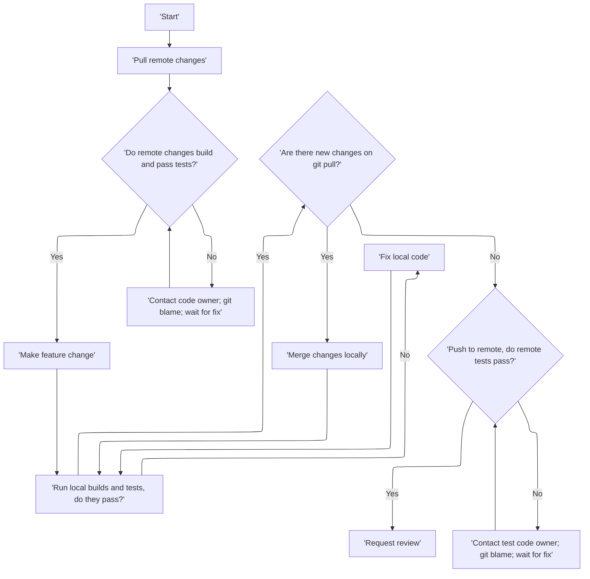

# Continuous integration
16th Sep 2026 - Andrew Naden
#continuous-integration

<!--toc:start-->
- [Continuous integration](#continuous-integration)
  - [Introduction](#introduction)
    - [Definition](#definition)
    - [Pros](#pros)
    - [Cons](#cons)
  - [Core requirements](#core-requirements)
    - [Version control system (VCS)](#version-control-system-vcs)
    - [Build](#build)
    - [Testing](#testing)
    - [Deployment](#deployment)
  - [Benchmarking performance as CI requirements](#benchmarking-performance-as-ci-requirements)
    - [Bencher and Chronologer](#bencher-and-chronologer)
  - [Styles of CI](#styles-of-ci)
    - [Scientific Software](#scientific-software)
  - [Structural concerns](#structural-concerns)
  - [Flowchart](#flowchart)
  - [Walkthrough](#walkthrough)
    - [SHAREing internal](#shareing-internal)
<!--toc:end-->

## Introduction
DISCLAIMER: It is important to note that while many aspects of continuous integration can be automated, fundamentally it is a system which must be adhered to by the developers of the software or tool in question in order to be useful. It is always possible to side step parts of a continuous integration system. While the automation of stages and tools can help make (CI) path of least resistance for developers, it is important to have a robust policy for access and practice data safety, in addition to any (CI) tests.
[abc](abced)
### Definition
Integrating changes to the software frequently, as well as ensuring that the integrated codebase is always left in a functioning/workable state. This can often be thought of as a practice of regular submitting of code changes, to a (shared) integration area with atomic commits that do not damage the  larger codebase; and the automated testing that verifies that any particular commit leaves the codebase in a functioning state. None of the process must be automated by definition however.

### Pros
 - Problems with commits can be detected before manual review, and before they are disseminated.
 - Provides a history of verified commits, with which a regression can be compared, and it's cause identified.
 - Integration of many small changes may be simpler than one large set of features.
 - Functioning codebase is available at all times, for parallel development work, or as a frequent/nightly release path.
 - Can encourage more modular code.
 - Code coverage can be measured as part of CI tests.

### Cons
 - Set up cost of CI.
 - Automated tests and test suites are only as useful as the test design. Poor test coverage or quality may lead to incorrect assumptions about when a regression is introduced. Poor test coverage can result in incorrect behaviour being accepted.
 - Build latency can slow down development and can be costly, especially for teams with regular and often commit schedules. This can necessitate a change in working structure.
 - Incomplete features and code should not be submitted to the integration area. This can cause work to be lost, or make collaborative efforts more difficult, as only finished work is visible to the whole team.
 - Safety or assurance certifications may require a separate process which reduces the effectiveness of the CI system in relation to setup and maintenance costs.
 - Changing specification of external CI computation can result in cost, time, or functionality changes in a test suite.
 - See 

## Core requirements
Shared integration area with regular testing of the program, either based on a regular interval or on changes to the integration area.
Examples include:
 - A server which regularly pulls a git repository, builds the program, and runs unit tests on the program.
 - Github actions, controlling a build and test process based on pushes to a repository.
 - Pre and post hooks within the version control system. These can operate before and after commits, pushes etc.

### Version control system (VCS)
     - Version control system  should allow for shared interaction and should be deterministic with respect to builds and tests.
     - VCS should allow for combining commits, to allow for a local history to be combined into one atomic change before submission.
### Build
 - Builds must be fast
    - Incremental builds can reduce build times, only rebuilding objects with rely on the files that were changed in the commit
    - Parallel builds reduce build time (but can increase cost of compute)
 - Builds must be automatic
    - Single action builds, e.g. make <target>
    - Builds as part of the test process on push
 - Every submitted commit should be atomic (function as a single update) and should build
 - Dependencies should be either bundled with the repository, or version pinned to guarantee operability
 - Build results should be public to the development team

Tools include:
 - Cmake (Meta build, produces configurations for e.g. Make)
 - Make
 - Ninja
 - Cargo
 - Bazel
 - Shell scripting

### Testing
 - Unit tests should be specific, tests should test a particular piece of functionality narrowly.
 - Integration tests should be more general, and should test several parts of the program in concert.
 - Tests should be performed in as similar to production environment as possible (ideally a complete clone)
 - Tests should be informative, a test should fail with appropriate diagnostic information available to the test system
 - Tests should not take a long time to run.
 - Tests should not be expensive to run.
 - Tests should be deterministic, or, where randomness is required, should still have a deterministic pass/fail condition that is independent.
 - See structural concerns

### Deployment
 - Successful builds can be automatically deployed to a nightly/develop branch, or to an internal test instance
    - This does not conflict with a particular release schedule, for example using semantic versioning, which may be produced during specific release windows
    - The successful build should be available to everyone internally, [see Build](#Build)
 - Failed builds should not be deployed. This includes both builds which did not complete, and builds which failed testing.
 - Deployment should be connected to a single instance of the codebase, for example, tied to a commit hash, Semantic versioning number or datetime.

## Benchmarking performance as CI requirements
Preventing performance regression can be an important aspect of updating code, but often performance regressions can go unnoticed due to separation between the testing and the modification. Adding a performance benchmark to CI can prevent this gap from occurring, but is computationally expensive if the heuristic for performing benchmark runs is not well adapted to code writing workflows. 
### Bencher and Chronologer
[Bencher](https://github.com/bencherdev/bencher) and [Chronologer](https://github.com/dandavison/chronologer) are tools with allow benchmarking performance to be used as part of the continuous integration process. 

Bencher allows for performance regressions to trigger failures in CI runs, and Chronologer allows for examining performance across an entire git tree.

## Styles of CI
Broadly the styles of CI can be thought of as a 2 dimensional space, with one dimensions referring to integration frequency, and one dimensions referring to number of development pipelines.
For example:

|                    | Low integration frequency               | High integration frequency                               |
|--------------------|-----------------------------------------|----------------------------------------------------------|
| **Low pipelines**  | Small project, solo developer           | Rapidly changing codebase, few developers                |
| **High pipelines** | Large project, with large units of work | Large codebase, many developers with many features added |

### Scientific Software
With respect to scientific software, it is possible that a single unit of work could be quite large, and require a high amount of collaborative development before it is functional. This is not necessarily completely at odds with this CI structure, but can reduce the benefits somewhat compared with a traditional release schedule driven development. 

Concerns around CI and scientific software include:
- Large work units 
- Development by non-developers, who may be unfamiliar with the practices required for CI
- Lack of access control leading to "out of channel" commits and development
- Requires some ownership of the CI system, which may be difficult for certain departments, or require ongoing support from a research computing department (e.g. ARC)

Extra benefits for scientific software development include:
 - Building and testing can be automated, reducing barrier for entry for new developers
 - Regressions can be found without dedicated quality assurance at every stage of the pipeline
 - System can be set up once, and continued to be used even if development is sporadic

## Structural concerns
 - Hard to control when the ratio of workers to work is low. i.e. open source projects with low frequency of commits per person -> Pull request workflow with dedicated testers. 
 - Hard to enforce; if the test suite is bad/avoidable; the mainline is frequently left in a broken state; integration is not sufficiently automated. [^1]

## Flowchart
The basic flowchart for a continuously integrated development cycle.

[^1]:[Martin Fowler](https://martinfowler.com/articles/continuousIntegration.html#StylesOfIntegration)

## Self hosted runners
In order to avoid the cost of using cloud hosted runners, or to evaluate the correctness of a codebase on specialised hardware, runners can be self hosted. The next blog article discussing this [can be found here.](self-hosted-runners.qmd)
